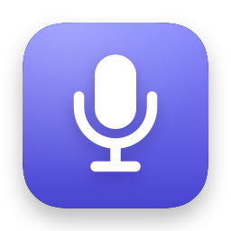
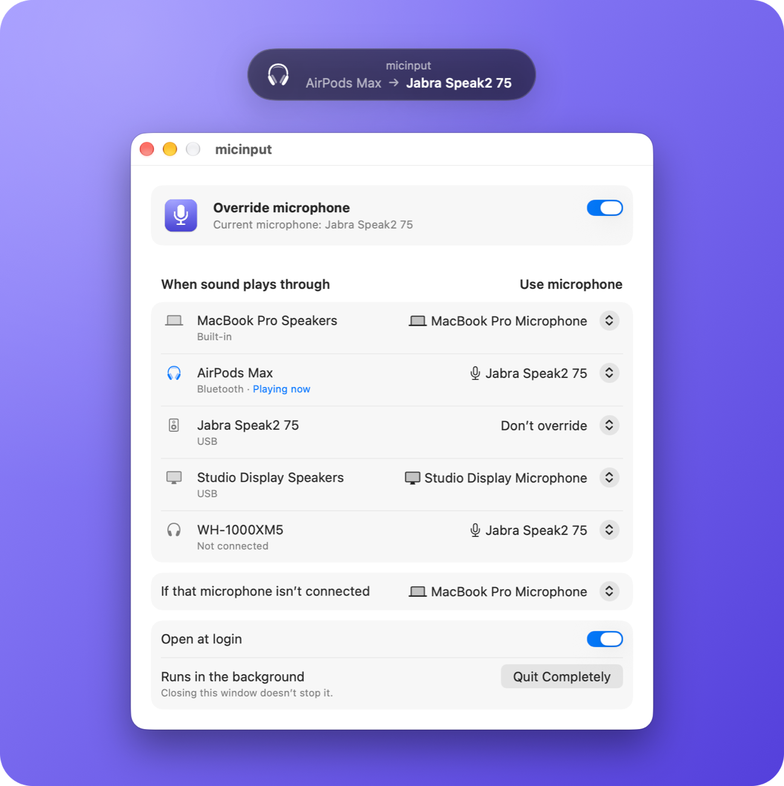

<p align="center">
  
</p>

<h1 align="center">micinput</h1>

<p align="center">
  <b>Your headphones keep hijacking your Mac's microphone.<br>micinput takes it back.</b>
</p>

<p align="center">
  
</p>

## The problem

Put on AirPods or any Bluetooth headset and macOS quietly makes *them* your microphone. You sound worse on calls and your music drops to call quality, while a far better mic sits on your desk.

## The fix

Tell micinput once which microphone goes with which device. Whenever macOS switches it, micinput switches it back and tells you with a small pop-up.

- **One rule per device.** AirPods → desk mic. Laptop speakers → built-in mic. Devices are remembered while they're away.
- **Made for docks.** Desk mic unplugged? micinput uses the fallback you chose, or leaves things alone.
- **Safe by default.** It only ever picks a microphone you chose yourself. No rule, no change.
- **Out of the way.** No Dock icon, no menu bar icon. Starts at login and idles at about 10 MB of memory and 0% CPU.
- **Private.** No permissions, no network, no analytics.

## Install

Requires macOS 26 or later.

**Download.** Get the `.dmg` from the [latest release](https://github.com/igaevd/micinput/releases/latest), open it and drag micinput to Applications.

macOS blocks the first launch because the app isn't notarized by Apple. Try to open it once, then go to **System Settings → Privacy & Security** and click **Open Anyway**. You only do this once.

**Or build it yourself.** This needs Xcode and skips the approval step:

```bash
git clone https://github.com/igaevd/micinput.git
cd micinput
./build.sh install
```

Then pick a microphone for each device, turn on **Override microphone** and close the window. micinput keeps working in the background; open the app again any time to change the rules.

## License

[MIT](LICENSE)
